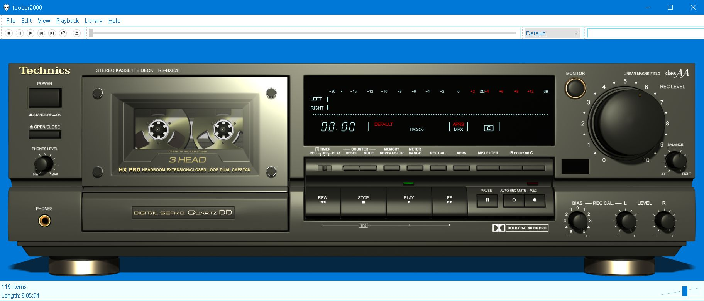
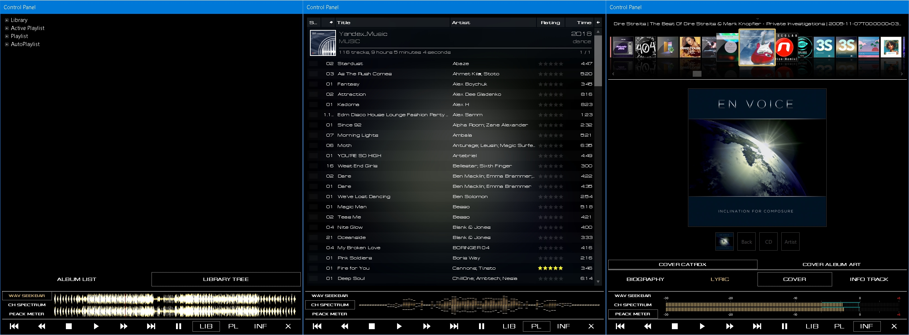
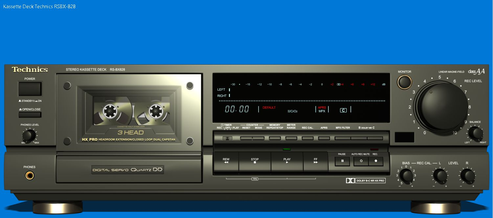
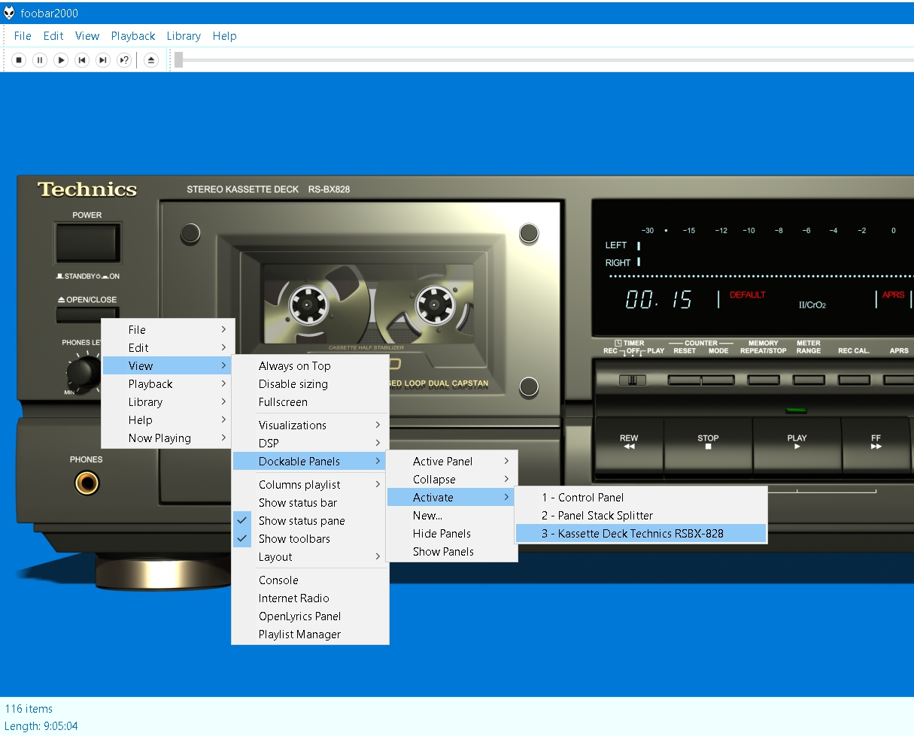
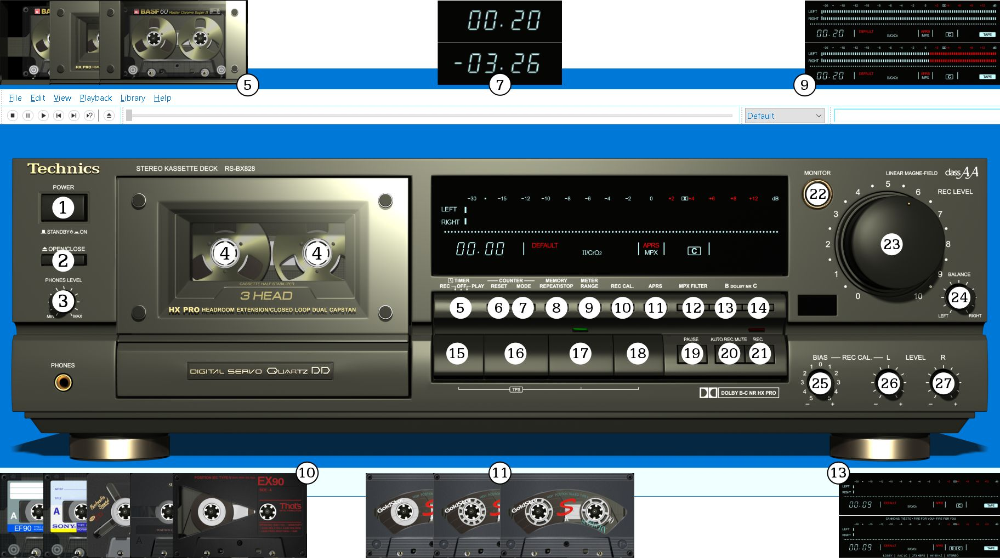
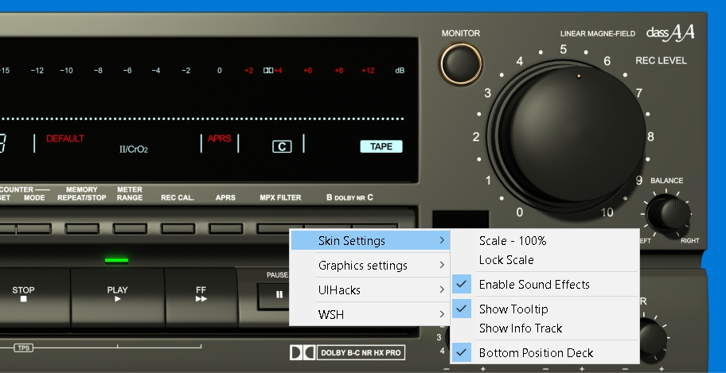
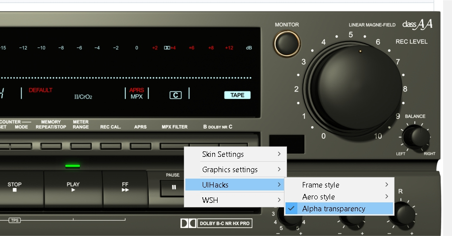
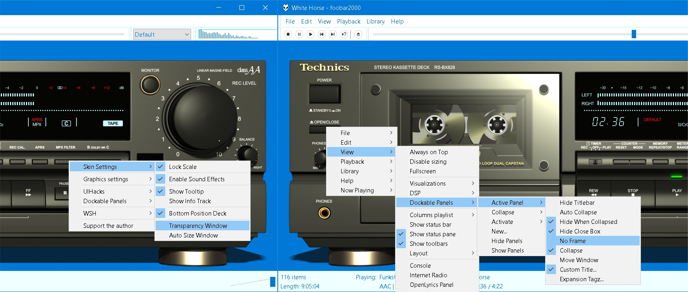

# Technics RSBX-828 Cassette Deck
Theme for [foobar2000](https://www.foobar2000.org), imitating the Technics RSBX-828 cassette deck

Реализована на основе [foo_uie_wsh_panel_mod_plus](https://github.com/ttsping/foo_uie_wsh_panel_mod_plus) от [ttsping](https://github.com/ttsping) под любое разрешение, вплоть до 4K.

Масштабируется по размеру окна. 

Доступно два варианта:
- Полная сборка [full.zip](full.zip)
- Файлы темы для интеграции в другие сборки [theme.zip](theme.zip)

## Полная сборка
Тема состоит из двух окон: 
- Кассетная дека в главном окне foobar2000

- Панель управления в отдельном окне на основе [foo_dockable_panels](http://wiki.bowron.us/index.php/Foobar2000) от Christopher Bowron  

### Установка
- Извлечь файлы из архива full.zip
- Установить шрифты из папки fonts архива full.zip (продублированы в foobar2000_hi-fi\themes\hi-fi\common\fonts)
  
  Установка завершена

## Файлы темы для интеграции в сборку
Архив содержит файлы темы и следующие компоненты:
- foo_dockable_panels
- foo_uie_wsh_panel_mod_plus
- foo_vis_vumeter

### Установка
- Сделать архив своей сборки
- Извлечь файлы из архива theme.zip в сборку
- Установить шрифт foobar2000_hi-fi\themes\hi-fi\common\fonts\lcd_technics_rsbx_828.ttf
- Разместить панель foo_uie_wsh_panel_mod_plus
- Загрузить в панель скрипт foobar2000_hi-fi\themes\hi-fi\cassette_deck_4k\Scripts\TechnicsRSBX_4K.txt

## Дополнение
В обоих вариантах есть настроенное окно на основе foo_dockable_panels.

Вызов окна:

## Управление

- 1 - Выход из foobar2000 (сворачивание окна деки foo_dockable_panels)
- 2 - Меню foobar2000
- 3 - Свободно (mouse drag / mouse wheel)
- 4 - Перемещение по треку (mouse drag / mouse wheel)
- 5 - Переключение вида крышки кассетного отсека
- 6 - Сброс счетчика на 0
- 7 - Переключение режима счетчика (прошло / осталось)
- 8 - Переключение Playback Order. Левая / правая часть кнопки  - / +
- 9 - Переключение вида индикатора (требуется foo_vis_vumeter) 
- 10 - Переключение вида кассеты. Левая часть кнопки - предыдущая, правая часть - следующая (mouse click / mouse wheel)
- 11 - Переключение вида катушки кассеты. Левая часть кнопки - предыдущая, правая часть - следующая (mouse click)
- 12 - Меню деки
- 13 - Переключение отображения информации о текущем треке
- 14 - Переключение отображения всплывающих подсказок
- 15 - Предыдущий трек. При удерживании кнопки перемещение по треку в обратную сторону. Шаг настраивается регулятором #27
- 16 - Stop
- 17 - Play
- 18 - Следующий трек. При удерживании кнопки перемещение по треку. Шаг настраивается регулятором #27
- 19 - Пауза
- 20 - Mute
- 21 - Вызов окна Quick Convert
- 22 - Вызов окна Control Panel
- 23 - Громкость (mouse drag / mouse wheel)
- 24 - Баланс (требуется foo_ui_hacks) (mouse drag / mouse wheel) 
- 25 - Скорость вращения катушек. По умолчанию 50 мс. При уменьшении интервала возрастает скорость вращения и нагрузка на процессор (mouse drag / mouse wheel)
- 26 - Свободно (mouse drag / mouse wheel)
- 27 - Шаг перемещения по треку. По умолчанию 3 секунды (mouse drag / mouse wheel)

### Перемещение мышью
- Перемещение деки в пределах окна: Shift + left button
- Перемещение окна: Ctrl + left button
- Выравнивание деки в окне: double click

### Меню деки

- Scale 100% - отображение деки в полном размере. Перемещение: Shift + left button 
- Lock Scale - блокировка текущего размера деки. При изменении размеров окна не происходит масштабирование
- Enable Sound Effects - воспроизводятся звуки нажатия кнопок
- Bottom Position Deck - расположение деки внизу окна. При отключении - по центру окна

Дополнительно для foo_dockable_panels:
  
- Transparency Window - Устанавливает прозрачный фон
- Auto Size Window - Установка размера окна под деку

### Прозрачный задний фон для темы в окне foobar2000
  

### Прозрачный задний фон для темы в окне foo_dockable_panels:

- Выбрать в меню темы Transparency Window
- Убрать рамку окна foo_dockable_panels

Поддержать автора

